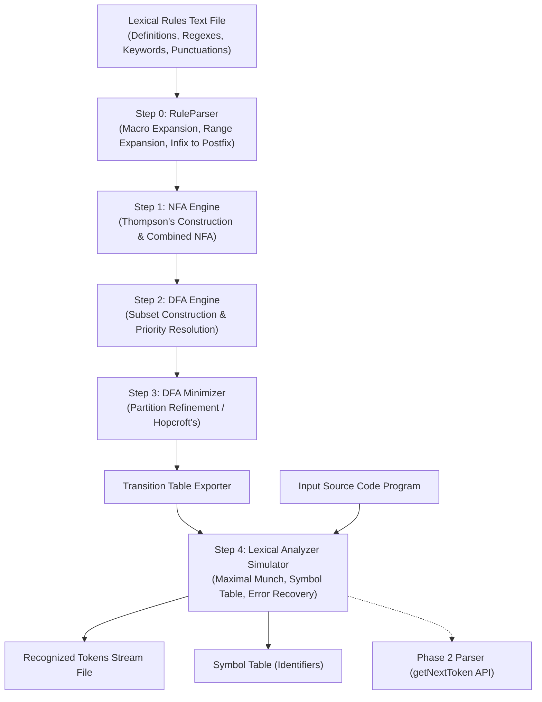

# Programming Languages and Compilers
## Phase 1: Lexical Analyzer Generator — Project Report
**Alexandria University — Faculty of Engineering**  
**Computer and Systems Engineering Department**  

---

## Table of Contents
1. [Executive Summary & System Architecture](#1-executive-summary--system-architecture)
2. [Section A: Description of Data Structures](#2-section-a-description-of-data-structures)
3. [Section B: Algorithms & Techniques Used](#3-section-b-algorithms--techniques-used)
4. [Section C: Resultant Transition Table for Minimal DFA](#4-section-c-resultant-transition-table-for-minimal-dfa)
5. [Section D: Resultant Stream of Tokens for Example Program](#5-section-d-resultant-stream-of-tokens-for-example-program)
6. [Section E: Assumptions Made and Justifications](#6-section-e-assumptions-made-and-justifications)
7. [Step-by-Step Implementation Status & Test Verification](#7-step-by-step-implementation-status--test-verification)

---

## 1. Executive Summary & System Architecture

The objective of Phase 1 is to build an automatic **Lexical Analyzer Generator** in C++. The tool reads language token definitions written in regular expressions, constructs Non-deterministic Finite Automata (NFAs), merges them into a Combined NFA, converts it to a Deterministic Finite Automaton (DFA), minimizes the DFA, and outputs the resulting transition table. It also simulates this DFA as a runtime scanner that matches input source code using the **Maximal Munch (longest prefix)** rule, manages a Symbol Table for identifiers, and integrates with the Phase 2 Parser via `getNextToken()`.



---

## 2. Section A: Description of Data Structures

### 2.1 Token Representation (`TokenType` & `RegexToken`)
Inside [`include/RegexToken.h`](../include/RegexToken.h), regular expressions are converted from raw text into a strongly typed token stream:
```cpp
enum class TokenType {
    LITERAL,    // Characters to match directly (e.g. 'a', '0', '+', '=')
    LAMBDA,     // \L (empty string / epsilon)
    CONCAT,     // Explicit concatenation operator (internal)
    UNION,      // |
    STAR,       // * (Kleene closure: 0 or more)
    PLUS,       // + (Positive closure: 1 or more)
    LPAREN,     // (
    RPAREN      // )
};

struct RegexToken {
    TokenType type;
    char value; // Meaningful when type == LITERAL
};
```
* **Why this structure**: It cleanly separates operators from literal characters. For instance, an escaped plus `\+` becomes `RegexToken(TokenType::LITERAL, '+')`, while a repeat plus `+` becomes `RegexToken(TokenType::PLUS, '+')`. This eliminates any ambiguity during automata construction.

### 2.2 Token Rule Definition (`TokenRule`)
Inside [`include/RuleParser.h`](../include/RuleParser.h), each language token is packaged with its priority and parsed representations:
```cpp
struct TokenRule {
    std::string name;                   // e.g. "id", "num", "relop", "int", ";"
    int priority;                       // Lower number = higher priority
    std::string rawRegex;               // Original expression from file
    std::string expandedRegex;          // After macro and range expansions
    std::vector<RegexToken> infix;      // Infix tokens with explicit CONCAT
    std::vector<RegexToken> postfix;    // Postfix (RPN) tokens for Thompson's
};
```

### 2.3 Automata Data Structures (`NFAState`, `NFAFragment`, and `NFA`)
Inside [`include/NFA.h`](../include/NFA.h) and [`include/NFABuilder.h`](../include/NFABuilder.h), the NFA graph is represented as an adjacency-list based structure:
```cpp
using namespace std;

struct NFAState {
    int id;
    bool isAccepting = false;
    string tokenName = "";   // e.g. "id", "num", "int", ";"
    int priority = -1;       // Lower number = higher priority

    // Character transitions: char -> set of target state IDs
    map<char, set<int>> transitions;

    // Epsilon / Lambda transitions: set of target state IDs
    set<int> epsilonTransitions;
};

// Represents a sub-automaton during Thompson's construction
struct NFAFragment {
    int start;
    int accept;
};

class NFA {
public:
    int startStateId = 0;
    vector<NFAState> states;
    set<char> alphabet; // All unique input characters recognized by this NFA

    int addState();
    void addTransition(int from, char input, int to);
    void addEpsilonTransition(int from, int to);
    void setAccepting(int stateId, const string& tokenName, int priority);
    vector<int> getAcceptingStates() const;
};
```
* **Why this structure**:
  * `NFAFragment` tracks the entry and exit of each sub-expression on the evaluation stack.
  * `map<char, set<int>>` and `set<int>` provide clean, deterministic iteration and fast lookups for both symbol transitions and $\epsilon$-closures.
  * Every state has a globally unique ID across the entire NFA, eliminating the need for state re-indexing or graph merging.

### 2.4 DFA State & Transition Table (For Steps 2–3)
* **DFA State**: Represents an $\epsilon$-closure set of NFA states (`set<int>`), carrying an `isAccepting` flag, the winning `tokenName`, and priority.
* **TransitionTable**: 2D mapping `table[stateId][inputChar] -> nextStateId`.

### 2.5 Symbol Table (For Step 4)
* Hash table / map (`unordered_map<string, SymbolEntry>`) storing identifier lexemes, token types, line numbers, and attribute values.

---

## 3. Section B: Algorithms & Techniques Used

### 3.1 Lexical Specification Parsing & Priority Assignment
* **Line Categorization**: Lines are identified as definitions (`=`), expressions (`:`), keywords (`{ }`), or punctuations (`[ ]`).
* **Reserved Priority**: Keywords are reserved words in the language and are assigned the highest priority levels ($0 \dots K-1$), followed by punctuations, followed by regular expressions in file appearance order.

### 3.2 Macro Definition & Range Expansion
* **Macro Substitution**: Regular definitions (e.g. `digit = 0 - 9`, `digits = digit+`) are expanded topologically and substituted into subsequent definitions and expressions using whole-word boundary matching.
* **Range Expansion**: Ranges like `a-z`, `A-Z`, and `0 - 9` are recognized and expanded into explicit character unions `(a|b|...|z)` and `(0|1|...|9)`, simplifying downstream Thompson's construction.

### 3.3 Explicit Concatenation Insertion
In standard regular expressions, concatenation is implicit (juxtaposition). Before conversion to postfix, an explicit `CONCAT` token is inserted between any adjacent pair of tokens where:
$$\text{prev} \in \{\text{LITERAL}, \text{LAMBDA}, \text{RPAREN}, \text{STAR}, \text{PLUS}\} \quad\text{and}\quad \text{curr} \in \{\text{LITERAL}, \text{LAMBDA}, \text{LPAREN}\}$$

### 3.4 Infix to Postfix Conversion (Dijkstra's Shunting-Yard)
To make Thompson's NFA construction a straightforward linear stack evaluation, infix expressions are converted to Postfix notation with the following precedence:
1. **Precedence 3 (Highest)**: Unary postfix operators (`*`, `+`) — emitted directly to output.
2. **Precedence 2**: Binary `CONCAT` (`.`) — left-associative.
3. **Precedence 1**: Binary `UNION` (`|`) — left-associative.
4. **Precedence 0**: Parentheses `(` and `)`.

### 3.5 Thompson's NFA Construction & Combined Master NFA
Each regular expression (in postfix notation) is evaluated linearly using a stack of `NFAFragment`s according to Ken Thompson's inductive construction:

1. **Literal Character (`c`)**: Creates two states $s$ and $a$, and a transition $s \xrightarrow{c} a$. Returns fragment $(s, a)$.
2. **Lambda ($\Lambda$ / $\epsilon$)**: Creates two states $s$ and $a$, and an $\epsilon$-transition $s \xrightarrow{\epsilon} a$. Returns fragment $(s, a)$.
3. **Concatenation ($A \cdot B$)**: Pops $B$, pops $A$. Connects $A$'s accept state to $B$'s start state via an $\epsilon$-transition: $A.\text{accept} \xrightarrow{\epsilon} B.\text{start}$. Returns fragment $(A.\text{start}, B.\text{accept})$.
4. **Union ($A \mid B$)**: Pops $B$, pops $A$. Creates a new start state $s$ and new accept state $a$. Adds $\epsilon$-transitions $s \xrightarrow{\epsilon} A.\text{start}$, $s \xrightarrow{\epsilon} B.\text{start}$, $A.\text{accept} \xrightarrow{\epsilon} a$, and $B.\text{accept} \xrightarrow{\epsilon} a$. Returns fragment $(s, a)$.
5. **Kleene Closure ($A^*$)**: Pops $A$. Creates new start $s$ and accept $a$. Adds $\epsilon$-transitions $s \xrightarrow{\epsilon} A.\text{start}$, $A.\text{accept} \xrightarrow{\epsilon} a$, loopback $A.\text{accept} \xrightarrow{\epsilon} A.\text{start}$, and bypass $s \xrightarrow{\epsilon} a$ (allowing zero occurrences). Returns fragment $(s, a)$.
6. **Positive Closure ($A^+$)**: Pops $A$. Identical to Kleene closure with loopback $A.\text{accept} \xrightarrow{\epsilon} A.\text{start}$, but **without** the bypass from start to accept (forcing at least 1 match). Returns fragment $(s, a)$.

#### Combined Master NFA
Once all 18 token rule NFAs are constructed:
* A single global **Master Start State** ($S_0$) is instantiated.
* An $\epsilon$-transition is added from $S_0$ directly to the start state of every individual token's NFA.
* Each token's accept state is labeled with its token class name (`boolean`, `int`, `id`, `num`, etc.) and its priority number.
* This prepares the NFA for Step 2 (Subset Construction), where the initial DFA state is the $\epsilon$-closure of $S_0$.

### 3.6 Automata Algorithms (Steps 2–4)
* **Subset Construction (NFA $\to$ DFA)**: Uses $\epsilon\text{-closure}$ and `move(T, a)`. If a DFA state contains accepting states from multiple tokens, the tie is broken in favor of the token with the lowest priority value.
* **DFA Minimization**: Hopcroft's algorithm / equivalence partitioning. **Crucial rule**: Accepting states of different token classes are placed in distinct initial partitions.
* **Simulation (Maximal Munch)**: Uses a forward pointer and backtrack buffer to find the longest matching prefix. If unmatched, an error recovery routine logs the unrecognized lexeme and advances by one character.

---

## 4. Section C: Resultant Transition Table for Minimal DFA
*(This section will be populated dynamically upon completion of Steps 2 & 3)*

* Status: Pipeline initialized. Minimal transition table will be emitted as a matrix and embedded here.

---

## 5. Section D: Resultant Stream of Tokens for Example Program
*(This section will be populated upon completion of Step 4)*

### Test Program
```java
int sum , count , pass , mnt; while (pass !=10)
{
pass = pass + 1 ;
}
```

### Resultant Token Stream
*(Generated token output one per line will be embedded here)*

---

## 6. Section E: Assumptions Made and Justifications

1. **Keywords are Reserved**: In the provided assignment specification, `id` is listed before `{boolean int float}`. In standard Java specifications, keywords are reserved words and can never be valid identifiers. Therefore, keywords are given top priority so they win any tie-break over `id`.
2. **Alphabet Scope**: The alphabet $\Sigma$ consists of standard ASCII characters (values 0–127).
3. **Decimal Point in Numbers**: In the specification `num: digit+ | digit+ . digits ( \L | E digits)`, the dot `.` is not escaped with `\` because Rule 7 of the specification does not designate `.` as an operator. Hence, `.` is treated as a literal decimal point character.
4. **Lambda ($\Lambda$)**: `\L` represents the empty string $\epsilon$. It is handled as a free $\epsilon$-transition during automata construction.
5. **Whitespace Handling**: Spaces, tabs, and newlines between tokens are optional and are skipped by the scanner prior to matching tokens.

---

## 7. Step-by-Step Implementation Status & Test Verification

| Step | Component | Status | Verification Summary |
|---|---|---|---|
| **Step 0** | **Rules Parser & Regex Preprocessor** | **COMPLETED** | Tested on all 18 language rules; macro expansion, escape handling, concatenation, and Shunting-Yard verified. |
| **Step 1** | **Thompson's NFA & Combined NFA** | **COMPLETED** | Stack-based Thompson's construction verified; Master start state $S_0$ combines 18 sub-NFAs (733 states, 77 alphabet symbols, 18 accepting states). |
| **Step 2** | **Subset Construction (NFA $\to$ DFA)** | *In Progress / Next* | Powerset construction & priority resolution. |
| **Step 3** | **DFA Minimization** | *Planned* | Partition refinement preserving token classes. |
| **Step 4** | **Simulator & Symbol Table** | *Planned* | Maximal munch, token stream emission, error recovery, `getNextToken()` API. |
| **Step 5** | **Testing on Sample Program** | *Planned* | Verification against expected sample output. |
| **Step 6** | **Bonus Task (Flex Report)** | *Planned* | Flex implementation with comparison screenshots. |

### Step 1 Verification Output:
```text
====================================================
        LEXICAL ANALYZER GENERATOR - STEP 1 TESTS   
====================================================

--- TEST 1: THOMPSON'S PRIMITIVES ---
 [PASS] createLiteral('x') creates 2 states with 'x' transition.
 [PASS] createLambda() creates 2 states with epsilon transition.
 [PASS] createConcat('a', 'b') connects fa.accept -> fb.start.
 [PASS] createUnion('a', 'b') correctly branches and joins via epsilon.
 [PASS] createStar('a') includes loopback and bypass epsilon transitions.
 [PASS] createPlus('a') includes loopback and NO bypass.

--- TEST 2: COMBINED MASTER NFA FROM RULES ---
Loaded 18 token rules from tests/lexical_rules.txt

Combined NFA Statistics:
  Total States: 733
  Start State:  0
  Alphabet Size: 77 unique characters
  Alphabet: [ ! ( ) * + , - . / 0 1 2 3 4 5 6 7 8 9 ; < = > A B C D E F G H I J K L M N O P Q R S T U V W X Y Z a b c d e f g h i j k l m n o p q r s t u v w x y z { } ]
 [PASS] Master start state (ID 0) has exactly 18 epsilon transitions (one per token rule).
 [PASS] Total accepting states count (18) matches rule count (18).

Accepting States in Combined NFA:
  State   14 -> boolean    (Priority 0)
  State 20   -> int        (Priority 1)
  State 30   -> float      (Priority 2)
  State 34   -> if         (Priority 3)
  State 42   -> else       (Priority 4)
  State 52   -> while      (Priority 5)
  State 54   -> ;          (Priority 6)
  State 56   -> ,          (Priority 7)
  State 58   -> (          (Priority 8)
  State 60   -> )          (Priority 9)
  State 62   -> {          (Priority 10)
  State 64   -> }          (Priority 11)
  State 518  -> id         (Priority 12)
  State 688  -> num        (Priority 13)
  State 718  -> relop      (Priority 14)
  State 720  -> assign     (Priority 15)
  State 726  -> addop      (Priority 16)
  State 732  -> mulop      (Priority 17)
 [PASS] All 18 distinct tokens have designated accepting states.
 [PASS] Keywords, identifiers, numbers, operators, and punctuations all verified.

ALL STEP 1 TESTS PASSED SUCCESSFULLY!
====================================================
```

### Step 0 Verification Output:
```text
====================================================
        LEXICAL ANALYZER GENERATOR - STEP 0 TESTS   
====================================================
SUCCESS: Successfully parsed 18 token rules.

--- REGULAR DEFINITIONS STORED ---
digit      = (0|1|2|3|4|5|6|7|8|9)
digits     = ((0|1|2|3|4|5|6|7|8|9))+
letter     = (a|b|c|d|e|f|g|h|i|j|k|l|m|n|o|p|q|r|s|t|u|v|w|x|y...

--- PARSED TOKEN RULES (Priority Order) ---
Prio  Token Name  Raw Regex                Postfix Preview
--------------------------------------------------------------------------------
0     boolean     boolean                  b o . o . l . e . a . n .
1     int         int                      i n . t .
2     float       float                    f l . o . a . t .
3     if          if                       i f .
4     else        else                     e l . s . e .
5     while       while                    w h . i . l . e .
6     ;           ;                        ;
7     ,           ,                        ,
8     (           (                        (
9     )           )                        )
10    {           {                        {
11    }           }                        }
12    id          letter (letter|digit)*   a b | c | d | e | f | g | h | i | j | k ...
13    num         digit+ | digit+ . digi...0 1 | 2 | 3 | 4 | 5 | 6 | 7 | 8 | 9 | + ...
14    relop       \=\= | !\= | > | >\= |...= = . ! = . | > | > = . | < | < = . |
15    assign      =                        =
16    addop       \+ | \-                  + - |
17    mulop       \* | /                   * / |

--- RUNNING VALIDATION CHECKS ---
 [PASS] Keywords are reserved and assigned highest priorities (0 to 5).
 [PASS] Punctuation symbols (;, ,, (, ), {, }) extracted correctly.
 [PASS] 'id' properly expanded macros and converted to postfix ending in CONCAT.
 [PASS] 'num' contains literal '.' decimal point and '\L' (Lambda/epsilon).
 [PASS] 'relop' handles escaped characters like \=\= and !\=.

--- UNIT TESTS: SHUNTING-YARD ALGORITHM ---
 [PASS] Postfix for 'a (b|c)*' is exactly 'a b c | * .'

ALL STEP 0 TESTS PASSED SUCCESSFULLY!
====================================================
```
