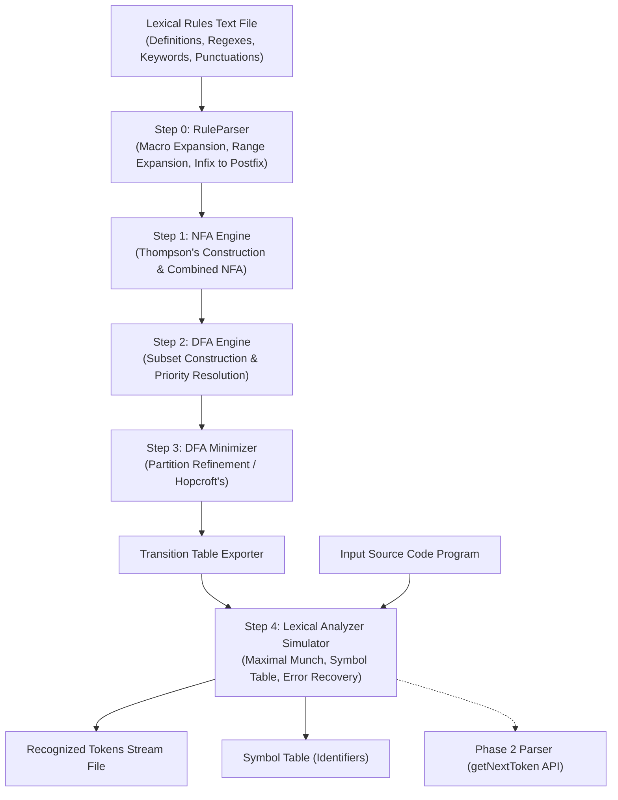

# Programming Languages and Compilers
## Phase 1: Lexical Analyzer Generator — Project Report
**Alexandria University — Faculty of Engineering**  
**Computer and Systems Engineering Department**  

---

## Table of Contents
1. [Executive Summary & System Architecture](#1-executive-summary--system-architecture)
2. [Section A: Description of Data Structures](#2-section-a-description-of-data-structures)
3. [Section B: Algorithms & Techniques Used](#3-section-b-algorithms--techniques-used)
4. [Section C: Resultant Transition Table for Minimal DFA](#4-section-c-resultant-transition-table-for-minimal-dfa)
5. [Section D: Resultant Stream of Tokens for Example Program](#5-section-d-resultant-stream-of-tokens-for-example-program)
6. [Section E: Assumptions Made and Justifications](#6-section-e-assumptions-made-and-justifications)
7. [Step-by-Step Implementation Status & Test Verification](#7-step-by-step-implementation-status--test-verification)

---

## 1. Executive Summary & System Architecture

The objective of Phase 1 is to build an automatic **Lexical Analyzer Generator** in C++. The tool reads language token definitions written in regular expressions, constructs Non-deterministic Finite Automata (NFAs), merges them into a Combined NFA, converts it to a Deterministic Finite Automaton (DFA), minimizes the DFA, and outputs the resulting transition table. It also simulates this DFA as a runtime scanner that matches input source code using the **Maximal Munch (longest prefix)** rule, manages a Symbol Table for identifiers, and integrates with the Phase 2 Parser via `getNextToken()`.



---

## 2. Section A: Description of Data Structures

### 2.1 Token Representation (`TokenType` & `RegexToken`)
Inside [`include/RegexToken.h`](../include/RegexToken.h), regular expressions are converted from raw text into a strongly typed token stream:
```cpp
enum class TokenType {
    LITERAL,    // Characters to match directly (e.g. 'a', '0', '+', '=')
    LAMBDA,     // \L (empty string / epsilon)
    CONCAT,     // Explicit concatenation operator (internal)
    UNION,      // |
    STAR,       // * (Kleene closure: 0 or more)
    PLUS,       // + (Positive closure: 1 or more)
    LPAREN,     // (
    RPAREN      // )
};

struct RegexToken {
    TokenType type;
    char value; // Meaningful when type == LITERAL
};
```
* **Why this structure**: It cleanly separates operators from literal characters. For instance, an escaped plus `\+` becomes `RegexToken(TokenType::LITERAL, '+')`, while a repeat plus `+` becomes `RegexToken(TokenType::PLUS, '+')`. This eliminates any ambiguity during automata construction.

### 2.2 Token Rule Definition (`TokenRule`)
Inside [`include/RuleParser.h`](../include/RuleParser.h), each language token is packaged with its priority and parsed representations:
```cpp
struct TokenRule {
    std::string name;                   // e.g. "id", "num", "relop", "int", ";"
    int priority;                       // Lower number = higher priority
    std::string rawRegex;               // Original expression from file
    std::string expandedRegex;          // After macro and range expansions
    std::vector<RegexToken> infix;      // Infix tokens with explicit CONCAT
    std::vector<RegexToken> postfix;    // Postfix (RPN) tokens for Thompson's
};
```

### 2.3 Automata Data Structures (`NFAState`, `NFAFragment`, and `NFA`)
Inside [`include/NFA.h`](../include/NFA.h) and [`include/NFABuilder.h`](../include/NFABuilder.h), the NFA graph is represented as an adjacency-list based structure:
```cpp
using namespace std;

struct NFAState {
    int id;
    bool isAccepting = false;
    string tokenName = "";   // e.g. "id", "num", "int", ";"
    int priority = -1;       // Lower number = higher priority

    // Character transitions: char -> set of target state IDs
    map<char, set<int>> transitions;

    // Epsilon / Lambda transitions: set of target state IDs
    set<int> epsilonTransitions;
};

// Represents a sub-automaton during Thompson's construction
struct NFAFragment {
    int start;
    int accept;
};

class NFA {
public:
    int startStateId = 0;
    vector<NFAState> states;
    set<char> alphabet; // All unique input characters recognized by this NFA

    int addState();
    void addTransition(int from, char input, int to);
    void addEpsilonTransition(int from, int to);
    void setAccepting(int stateId, const string& tokenName, int priority);
    vector<int> getAcceptingStates() const;
};
```
* **Why this structure**:
  * `NFAFragment` tracks the entry and exit of each sub-expression on the evaluation stack.
  * `map<char, set<int>>` and `set<int>` provide clean, deterministic iteration and fast lookups for both symbol transitions and $\epsilon$-closures.
  * Every state has a globally unique ID across the entire NFA, eliminating the need for state re-indexing or graph merging.

### 2.4 DFA State & Transition Table (`DFAState` and `DFA`)
Inside [`include/DFA.h`](../include/DFA.h), the DFA mirrors the NFA structure but allows **exactly one** target per character:
```cpp
struct DFAState {
    int id;
    bool isAccepting = false;
    string tokenName = "";   // Winning token class (e.g. "id", "num", "if")
    int priority = -1;       // Priority of the winning token (lower = higher priority)

    // Deterministic transitions: character -> exactly one target state ID.
    // A missing entry means "no transition" (implicit dead state).
    map<char, int> transitions;

    // The set of NFA state IDs this DFA state represents (filled by subset construction).
    // Empty for states of a minimized DFA.
    set<int> nfaStates;
};

class DFA {
public:
    static const int NO_STATE = -1;   // Returned when there is no transition

    int startStateId = 0;
    vector<DFAState> states;
    set<char> alphabet;               // All unique input characters used by this DFA

    int addState();
    void addTransition(int from, char input, int to);
    void setAccepting(int stateId, const string& tokenName, int priority);
    int getNextState(int stateId, char input) const;      // NO_STATE if no move
    bool isAccepting(int stateId) const;
    string getAcceptingToken(int stateId) const;
    vector<int> getAcceptingStates() const;
    string matchWhole(const string& input) const;         // whole-string match (used by tests)

    void printTransitionTable(ostream& out) const;
    bool saveTransitionTableCSV(const string& filePath) const;
    bool saveTransitionTableText(const string& filePath) const;
};
```
* **Why this structure**:
  * `map<char, int>` (instead of the NFA's `map<char, set<int>>`) enforces determinism: one character leads to at most one state.
  * A **missing** map entry means "no move". This is an *implicit dead state*: it keeps the table small and is exactly what the Step 4 scanner needs to know when to stop and fall back to the last accepting state.
  * `nfaStates` stores the group of NFA states that a DFA state stands for, so subset construction can recognise a group it has already seen. It is empty after minimization.
  * `getNextState`, `isAccepting` and `getAcceptingToken` are the only functions the Step 4 scanner needs to simulate the machine.
* **Transition table**: conceptually a 2D mapping `table[stateId][inputChar] -> nextStateId`. It is stored sparsely in each state's `transitions` map and exported as a dense matrix (rows = states, columns = alphabet) by `printTransitionTable`, `saveTransitionTableText` and `saveTransitionTableCSV`.

### 2.5 Symbol Table (For Step 4)
* Hash table / map (`unordered_map<string, SymbolEntry>`) storing identifier lexemes, token types, line numbers, and attribute values.

---

## 3. Section B: Algorithms & Techniques Used

### 3.1 Lexical Specification Parsing & Priority Assignment
* **Line Categorization**: Lines are identified as definitions (`=`), expressions (`:`), keywords (`{ }`), or punctuations (`[ ]`).
* **Reserved Priority**: Keywords are reserved words in the language and are assigned the highest priority levels ($0 \dots K-1$), followed by punctuations, followed by regular expressions in file appearance order.

### 3.2 Macro Definition & Range Expansion
* **Macro Substitution**: Regular definitions (e.g. `digit = 0 - 9`, `digits = digit+`) are expanded topologically and substituted into subsequent definitions and expressions using whole-word boundary matching.
* **Range Expansion**: Ranges like `a-z`, `A-Z`, and `0 - 9` are recognized and expanded into explicit character unions `(a|b|...|z)` and `(0|1|...|9)`, simplifying downstream Thompson's construction.

### 3.3 Explicit Concatenation Insertion
In standard regular expressions, concatenation is implicit (juxtaposition). Before conversion to postfix, an explicit `CONCAT` token is inserted between any adjacent pair of tokens where:
$$\text{prev} \in \{\text{LITERAL}, \text{LAMBDA}, \text{RPAREN}, \text{STAR}, \text{PLUS}\} \quad\text{and}\quad \text{curr} \in \{\text{LITERAL}, \text{LAMBDA}, \text{LPAREN}\}$$

### 3.4 Infix to Postfix Conversion (Dijkstra's Shunting-Yard)
To make Thompson's NFA construction a straightforward linear stack evaluation, infix expressions are converted to Postfix notation with the following precedence:
1. **Precedence 3 (Highest)**: Unary postfix operators (`*`, `+`) — emitted directly to output.
2. **Precedence 2**: Binary `CONCAT` (`.`) — left-associative.
3. **Precedence 1**: Binary `UNION` (`|`) — left-associative.
4. **Precedence 0**: Parentheses `(` and `)`.

### 3.5 Thompson's NFA Construction & Combined Master NFA
Each regular expression (in postfix notation) is evaluated linearly using a stack of `NFAFragment`s according to Ken Thompson's inductive construction:

1. **Literal Character (`c`)**: Creates two states $s$ and $a$, and a transition $s \xrightarrow{c} a$. Returns fragment $(s, a)$.
2. **Lambda ($\Lambda$ / $\epsilon$)**: Creates two states $s$ and $a$, and an $\epsilon$-transition $s \xrightarrow{\epsilon} a$. Returns fragment $(s, a)$.
3. **Concatenation ($A \cdot B$)**: Pops $B$, pops $A$. Connects $A$'s accept state to $B$'s start state via an $\epsilon$-transition: $A.\text{accept} \xrightarrow{\epsilon} B.\text{start}$. Returns fragment $(A.\text{start}, B.\text{accept})$.
4. **Union ($A \mid B$)**: Pops $B$, pops $A$. Creates a new start state $s$ and new accept state $a$. Adds $\epsilon$-transitions $s \xrightarrow{\epsilon} A.\text{start}$, $s \xrightarrow{\epsilon} B.\text{start}$, $A.\text{accept} \xrightarrow{\epsilon} a$, and $B.\text{accept} \xrightarrow{\epsilon} a$. Returns fragment $(s, a)$.
5. **Kleene Closure ($A^*$)**: Pops $A$. Creates new start $s$ and accept $a$. Adds $\epsilon$-transitions $s \xrightarrow{\epsilon} A.\text{start}$, $A.\text{accept} \xrightarrow{\epsilon} a$, loopback $A.\text{accept} \xrightarrow{\epsilon} A.\text{start}$, and bypass $s \xrightarrow{\epsilon} a$ (allowing zero occurrences). Returns fragment $(s, a)$.
6. **Positive Closure ($A^+$)**: Pops $A$. Identical to Kleene closure with loopback $A.\text{accept} \xrightarrow{\epsilon} A.\text{start}$, but **without** the bypass from start to accept (forcing at least 1 match). Returns fragment $(s, a)$.

#### Combined Master NFA
Once all 18 token rule NFAs are constructed:
* A single global **Master Start State** ($S_0$) is instantiated.
* An $\epsilon$-transition is added from $S_0$ directly to the start state of every individual token's NFA.
* Each token's accept state is labeled with its token class name (`boolean`, `int`, `id`, `num`, etc.) and its priority number.
* This prepares the NFA for Step 2 (Subset Construction), where the initial DFA state is the $\epsilon$-closure of $S_0$.

### 3.6 Subset Construction: NFA $\to$ DFA (Step 2)
Implemented in [`DFABuilder`](../src/DFABuilder.cpp). Every DFA state stands for a **set of NFA states** that the NFA could be in at the same time after reading the same input.

* **$\epsilon$-closure** (`DFABuilder::epsilonClosure`): all NFA states reachable from a set $T$ using only $\epsilon$-transitions (including $T$ itself). It uses a work-stack: pop a state, push every $\epsilon$-target that is not yet in the result. Because a target is only pushed when it is *new*, $\epsilon$-cycles cannot loop forever.
* **move** (`DFABuilder::move`): $\text{move}(T, c)$ = all NFA states reachable from any state of $T$ by reading the single character $c$ (no $\epsilon$-moves yet).
* **Algorithm** (`DFABuilder::buildFromNFA`):
  1. The start DFA state is $\epsilon\text{-closure}(\{S_0\})$, where $S_0$ is the Master Start State. It receives ID 0.
  2. Keep a dictionary `map<set<int>, int>` from NFA-state-sets to DFA state IDs, and a queue of DFA states whose transitions are not computed yet.
  3. Take a DFA state $D$ from the queue. For every character $c$ in the alphabet, compute $U = \epsilon\text{-closure}(\text{move}(D, c))$.
  4. If $U$ is empty there is no transition (implicit dead state). Otherwise find or create the DFA state for $U$ (new states are queued) and record $D \xrightarrow{c} U$.
  5. Repeat until the queue is empty.
* **Priority resolution (tie-break)**: when a DFA state contains accepting NFA states of several tokens, it becomes accepting for the token with the **lowest priority number** (the rule listed first). For example, the group reached after reading `i`, `f` contains both `if` (priority 3) and `id` (priority 12), so it accepts as `if`. This is what makes keywords win over identifiers.
* **Result on the assignment rules**: the 733-state Combined NFA becomes a **185-state DFA**.

### 3.7 DFA Minimization (Step 3)
Implemented in [`DFAMinimizer`](../src/DFAMinimizer.cpp) using **partition refinement** (Moore's equivalence-partitioning algorithm; it yields the same minimal DFA as Hopcroft's algorithm and is simpler to implement).

1. **Remove unreachable states**: a BFS from the start state marks every reachable state; the rest are ignored.
2. **Initial partition**: reachable states are split into *non-accepting* states, and *accepting states grouped by token class*. **Crucial rule**: accepting states of different token classes (e.g. `id` vs `num` vs `if`) are never placed in the same initial group, otherwise the lexer would lose track of which token was matched.
3. **Refinement**: every state gets a *signature* = (its current group, the group reached on every character). A missing transition counts as a special "dead" group (`-1`). States with the same signature stay together; states with different signatures are split into new groups. This repeats until a full pass splits nothing.
4. **Build the minimal DFA**: one new state per final group, with the transitions and token class taken from any member of the group. States are numbered in **BFS order from the start state** (start state = 0, deterministic output on every run).
* **Result on the assignment rules**: the 185-state DFA shrinks to a **44-state minimal DFA** (40 accepting states, all 18 token classes preserved). Minimizing the result a second time changes nothing, which confirms it is minimal.

### 3.8 Simulation (Maximal Munch) (Step 4, planned)
* **Simulation (Maximal Munch)**: Uses a forward pointer and backtrack buffer to find the longest matching prefix. If unmatched, an error recovery routine logs the unrecognized lexeme and advances by one character.

---

## 4. Section C: Resultant Transition Table for Minimal DFA

The table below is produced automatically from `tests/lexical_rules.txt` by the pipeline *RuleParser → NFABuilder → DFABuilder → DFAMinimizer*; nothing is typed by hand.

| Stage | Number of states |
|---|---|
| Combined NFA (Step 1) | 733 |
| DFA after subset construction (Step 2) | 185 |
| **Minimal DFA (Step 3)** | **44** (40 accepting) |

### How to read the table
* Each **row is a state**; the start state is **0** (marked ▶). A state marked `*` is **accepting**, and the *Accepts* column gives the token class.
* Each **number is a destination**: "on this character, move to this state". A state lists only the characters that are allowed next; every other character means *no move*. A row with several numbers therefore means several characters are allowed next, and a row with none means the token is always complete at that point (e.g. `(`, `)`, `+`, `*`).
* *Reached by* gives the shortest input that leads to the state, which shows what the state "remembers" (for example state 15 means "I have read `i`", state 24 means "I have read `if`").
* Letters and digits are grouped to keep the table readable.

Example trace for `while`: `0 -w-> 16 -h-> 26 -i-> 32 -l-> 37 -e-> 41`, and state 41 accepts as `while`.

### Minimal DFA transition table (compact form)

| State | Accepts | Reached by | Moves (characters → next state) |
|---|---|---|---|
| **▶ 0** |  | *(start)* | `!` → **1**<br>`(` → **2**<br>`)` → **3**<br>`*` `/` → **4**<br>`+` `-` → **5**<br>`,` → **6**<br>any digit → **7**<br>`;` → **8**<br>`<` `>` → **9**<br>`=` → **10**<br>any letter except b,e,f,i,w → **11**<br>`b` → **12**<br>`e` → **13**<br>`f` → **14**<br>`i` → **15**<br>`w` → **16**<br>`{` → **17**<br>`}` → **18** |
| **1** |  | `!` | `=` → **19** |
| **2\*** | `(` | `(` | *(none — token is complete)* |
| **3\*** | `)` | `)` | *(none — token is complete)* |
| **4\*** | `mulop` | `*` | *(none — token is complete)* |
| **5\*** | `addop` | `+` | *(none — token is complete)* |
| **6\*** | `,` | `,` | *(none — token is complete)* |
| **7\*** | `num` | `0` | any digit → **7**<br>`.` → **20** |
| **8\*** | `;` | `;` | *(none — token is complete)* |
| **9\*** | `relop` | `<` | `=` → **19** |
| **10\*** | `assign` | `=` | `=` → **19** |
| **11\*** | `id` | `a` | any letter, any digit → **11** |
| **12\*** | `id` | `b` | any letter except o, any digit → **11**<br>`o` → **21** |
| **13\*** | `id` | `e` | any letter except l, any digit → **11**<br>`l` → **22** |
| **14\*** | `id` | `f` | any letter except l, any digit → **11**<br>`l` → **23** |
| **15\*** | `id` | `i` | any letter except f,n, any digit → **11**<br>`f` → **24**<br>`n` → **25** |
| **16\*** | `id` | `w` | any letter except h, any digit → **11**<br>`h` → **26** |
| **17\*** | `{` | `{` | *(none — token is complete)* |
| **18\*** | `}` | `}` | *(none — token is complete)* |
| **19\*** | `relop` | `!=` | *(none — token is complete)* |
| **20** |  | `0.` | any digit → **27** |
| **21\*** | `id` | `bo` | any letter except o, any digit → **11**<br>`o` → **28** |
| **22\*** | `id` | `el` | any letter except s, any digit → **11**<br>`s` → **29** |
| **23\*** | `id` | `fl` | any letter except o, any digit → **11**<br>`o` → **30** |
| **24\*** | `if` | `if` | any letter, any digit → **11** |
| **25\*** | `id` | `in` | any letter except t, any digit → **11**<br>`t` → **31** |
| **26\*** | `id` | `wh` | any letter except i, any digit → **11**<br>`i` → **32** |
| **27\*** | `num` | `0.0` | any digit → **27**<br>`E` → **33** |
| **28\*** | `id` | `boo` | any letter except l, any digit → **11**<br>`l` → **34** |
| **29\*** | `id` | `els` | any letter except e, any digit → **11**<br>`e` → **35** |
| **30\*** | `id` | `flo` | any letter except a, any digit → **11**<br>`a` → **36** |
| **31\*** | `int` | `int` | any letter, any digit → **11** |
| **32\*** | `id` | `whi` | any letter except l, any digit → **11**<br>`l` → **37** |
| **33** |  | `0.0E` | any digit → **38** |
| **34\*** | `id` | `bool` | any letter except e, any digit → **11**<br>`e` → **39** |
| **35\*** | `else` | `else` | any letter, any digit → **11** |
| **36\*** | `id` | `floa` | any letter except t, any digit → **11**<br>`t` → **40** |
| **37\*** | `id` | `whil` | any letter except e, any digit → **11**<br>`e` → **41** |
| **38\*** | `num` | `0.0E0` | any digit → **38** |
| **39\*** | `id` | `boole` | any letter except a, any digit → **11**<br>`a` → **42** |
| **40\*** | `float` | `float` | any letter, any digit → **11** |
| **41\*** | `while` | `while` | any letter, any digit → **11** |
| **42\*** | `id` | `boolea` | any letter except n, any digit → **11**<br>`n` → **43** |
| **43\*** | `boolean` | `boolean` | any letter, any digit → **11** |

### Full matrix (all 77 characters)
The complete 44 × 77 matrix is emitted by the program in two formats (for the report and for spreadsheets):
* [`minimal_dfa_table.txt`](minimal_dfa_table.txt): aligned text, rows = states, columns = alphabet characters, `-` = no transition.
* [`minimal_dfa_table.csv`](minimal_dfa_table.csv): the same matrix as CSV (State, Start, Accepting, Token, then one column per character).

They are generated by `DFA::saveTransitionTableText` and `DFA::saveTransitionTableCSV` (see `tests/test_step3.cpp`).

---

## 5. Section D: Resultant Stream of Tokens for Example Program
*(This section will be populated upon completion of Step 4)*

### Test Program
```java
int sum , count , pass , mnt; while (pass !=10)
{
pass = pass + 1 ;
}
```

### Resultant Token Stream
*(Generated token output one per line will be embedded here)*

---

## 6. Section E: Assumptions Made and Justifications

1. **Keywords are Reserved**: In the provided assignment specification, `id` is listed before `{boolean int float}`. In standard Java specifications, keywords are reserved words and can never be valid identifiers. Therefore, keywords are given top priority so they win any tie-break over `id`.
2. **Alphabet Scope**: The alphabet $\Sigma$ consists of standard ASCII characters (values 0–127).
3. **Decimal Point in Numbers**: In the specification `num: digit+ | digit+ . digits ( \L | E digits)`, the dot `.` is not escaped with `\` because Rule 7 of the specification does not designate `.` as an operator. Hence, `.` is treated as a literal decimal point character.
4. **Lambda ($\Lambda$)**: `\L` represents the empty string $\epsilon$. It is handled as a free $\epsilon$-transition during automata construction.
5. **Whitespace Handling**: Spaces, tabs, and newlines between tokens are optional and are skipped by the scanner prior to matching tokens.
6. **Implicit Dead State**: The DFA and the minimal DFA do not store an explicit dead (trap) state. A missing transition means "no move". This keeps the table small, and the scanner only needs to know that no move exists in order to stop and fall back to the last accepting state.
7. **Tie-Break by Rule Order**: When several rules accept the same longest prefix, the rule listed first (lowest priority number) wins, as required by the assignment. Keywords and punctuation come before `id`, `num` and the operators.
8. **Token Classes Are Never Merged**: During minimization, accepting states of different token classes are kept in separate groups, even when their outgoing transitions look identical.
9. **Table Format**: The assignment lets us choose the output format of the transition table, so the minimal DFA is emitted as an aligned text matrix and as a CSV file (rows = states, columns = alphabet characters).

---

## 7. Step-by-Step Implementation Status & Test Verification

| Step | Component | Status | Verification Summary |
|---|---|---|---|
| **Step 0** | **Rules Parser & Regex Preprocessor** | **COMPLETED** | Tested on all 18 language rules; macro expansion, escape handling, concatenation, and Shunting-Yard verified. |
| **Step 1** | **Thompson's NFA & Combined NFA** | **COMPLETED** | Stack-based Thompson's construction verified; Master start state $S_0$ combines 18 sub-NFAs (733 states, 77 alphabet symbols, 18 accepting states). |
| **Step 2** | **Subset Construction (NFA $\to$ DFA)** | **COMPLETED** | $\epsilon$-closure, `move` and priority resolution verified; the 733-state NFA becomes a 185-state DFA, which agrees with direct NFA simulation on 20,000 random strings. |
| **Step 3** | **DFA Minimization** | **COMPLETED** | Partition refinement preserving token classes; the DFA shrinks from 185 to 44 states, behaves identically on 30,000 random strings, and is already minimal (re-minimizing changes nothing). |
| **Step 4** | **Simulator & Symbol Table** | *Planned* | Maximal munch, token stream emission, error recovery, `getNextToken()` API. |
| **Step 5** | **Testing on Sample Program** | *Planned* | Verification against expected sample output. |
| **Step 6** | **Bonus Task (Flex Report)** | *Planned* | Flex implementation with comparison screenshots. |

### Step 3 Verification Output:
```text
====================================================
        LEXICAL ANALYZER GENERATOR - STEP 3 TESTS   
====================================================

--- TEST 1: MINIMIZATION ON A HAND-BUILT DFA ---
 [PASS] equivalent states 1 and 2 merged (4 -> 3 states).
 [PASS] minimized DFA accepts the same language.
 [PASS] accepting states of different token classes stay separate.
 [PASS] unreachable states are removed.

--- TEST 2: MINIMIZATION ON THE ASSIGNMENT RULES ---
Combined NFA states : 733
DFA states          : 185
Minimal DFA states  : 44
DFA Summary:
  Total States: 44
  Start State:  0
  Alphabet Size: 77 characters
  Accepting States (40):
    State    2 -> Token: (          (Priority 8)
    State    3 -> Token: )          (Priority 9)
    State    4 -> Token: mulop      (Priority 17)
    State    5 -> Token: addop      (Priority 16)
    State    6 -> Token: ,          (Priority 7)
    State    7 -> Token: num        (Priority 13)
    State    8 -> Token: ;          (Priority 6)
    State    9 -> Token: relop      (Priority 14)
    State   10 -> Token: assign     (Priority 15)
    State   11 -> Token: id         (Priority 12)
    State   12 -> Token: id         (Priority 12)
    State   13 -> Token: id         (Priority 12)
    State   14 -> Token: id         (Priority 12)
    State   15 -> Token: id         (Priority 12)
    State   16 -> Token: id         (Priority 12)
    State   17 -> Token: {          (Priority 10)
    State   18 -> Token: }          (Priority 11)
    State   19 -> Token: relop      (Priority 14)
    State   21 -> Token: id         (Priority 12)
    State   22 -> Token: id         (Priority 12)
    State   23 -> Token: id         (Priority 12)
    State   24 -> Token: if         (Priority 3)
    State   25 -> Token: id         (Priority 12)
    State   26 -> Token: id         (Priority 12)
    State   27 -> Token: num        (Priority 13)
    State   28 -> Token: id         (Priority 12)
    State   29 -> Token: id         (Priority 12)
    State   30 -> Token: id         (Priority 12)
    State   31 -> Token: int        (Priority 1)
    State   32 -> Token: id         (Priority 12)
    State   34 -> Token: id         (Priority 12)
    State   35 -> Token: else       (Priority 4)
    State   36 -> Token: id         (Priority 12)
    State   37 -> Token: id         (Priority 12)
    State   38 -> Token: num        (Priority 13)
    State   39 -> Token: id         (Priority 12)
    State   40 -> Token: float      (Priority 2)
    State   41 -> Token: while      (Priority 5)
    State   42 -> Token: id         (Priority 12)
    State   43 -> Token: boolean    (Priority 0)
 [PASS] minimal DFA is not larger than the DFA; start state is 0.
 [PASS] all 18 token classes are still present.
 [PASS] minimizing again does not shrink it (already minimal).
 [PASS] minimal DFA behaves exactly like the DFA on 30000 random strings.
 [PASS] spot checks (while / whilex / 12.5E3 / != / pass).
 [PASS] transition table written to minimal_dfa_table.txt and minimal_dfa_table.csv.

--- MINIMAL DFA TRANSITION TABLE ---
(the 44 x 77 matrix is printed here by the program; see Section C and minimal_dfa_table.txt / .csv)

ALL STEP 3 TESTS PASSED SUCCESSFULLY!
====================================================
```

### Step 2 Verification Output:
```text
====================================================
        LEXICAL ANALYZER GENERATOR - STEP 2 TESTS   
====================================================

--- TEST 1: EPSILON-CLOSURE & MOVE ---
 [PASS] epsilon-closure({0}) = {0,1,2}.
 [PASS] move({0,1,2}, 'a') = {3,4}.
 [PASS] move on a character with no transition is empty.
 [PASS] epsilon-closure terminates on epsilon cycles.

--- TEST 2: SUBSET CONSTRUCTION ON SMALL RULES ---
 [PASS] "if" -> keyword 'if' (higher priority wins over 'id').
 [PASS] "i", "iff", "abc" -> 'id'.
 [PASS] empty string and non-matching input are rejected.
 [PASS] every transition points to a valid DFA state.
 [PASS] accepting state for 'if' has priority 0.

--- TEST 3: SUBSET CONSTRUCTION ON THE ASSIGNMENT RULES ---
Combined NFA states: 733
DFA Summary:
  Total States: 185
  Start State:  0
  Alphabet Size: 77 characters
  Accepting States (181):
    ... (all 181 accepting DFA states are listed by the program; omitted here for brevity)
 [PASS] DFA built; start state is 0; alphabet equals the NFA alphabet.
 [PASS] 44 token / non-token strings classified correctly.
 [PASS] DFA agrees with direct NFA simulation on 20000 random strings.
 [PASS] all accepting DFA states carry valid token names.

ALL STEP 2 TESTS PASSED SUCCESSFULLY!
====================================================
```

### Step 1 Verification Output:
```text
====================================================
        LEXICAL ANALYZER GENERATOR - STEP 1 TESTS   
====================================================

--- TEST 1: THOMPSON'S PRIMITIVES ---
 [PASS] createLiteral('x') creates 2 states with 'x' transition.
 [PASS] createLambda() creates 2 states with epsilon transition.
 [PASS] createConcat('a', 'b') connects fa.accept -> fb.start.
 [PASS] createUnion('a', 'b') correctly branches and joins via epsilon.
 [PASS] createStar('a') includes loopback and bypass epsilon transitions.
 [PASS] createPlus('a') includes loopback and NO bypass.

--- TEST 2: COMBINED MASTER NFA FROM RULES ---
Loaded 18 token rules from tests/lexical_rules.txt

Combined NFA Statistics:
  Total States: 733
  Start State:  0
  Alphabet Size: 77 unique characters
  Alphabet: [ ! ( ) * + , - . / 0 1 2 3 4 5 6 7 8 9 ; < = > A B C D E F G H I J K L M N O P Q R S T U V W X Y Z a b c d e f g h i j k l m n o p q r s t u v w x y z { } ]
 [PASS] Master start state (ID 0) has exactly 18 epsilon transitions (one per token rule).
 [PASS] Total accepting states count (18) matches rule count (18).

Accepting States in Combined NFA:
  State   14 -> boolean    (Priority 0)
  State 20   -> int        (Priority 1)
  State 30   -> float      (Priority 2)
  State 34   -> if         (Priority 3)
  State 42   -> else       (Priority 4)
  State 52   -> while      (Priority 5)
  State 54   -> ;          (Priority 6)
  State 56   -> ,          (Priority 7)
  State 58   -> (          (Priority 8)
  State 60   -> )          (Priority 9)
  State 62   -> {          (Priority 10)
  State 64   -> }          (Priority 11)
  State 518  -> id         (Priority 12)
  State 688  -> num        (Priority 13)
  State 718  -> relop      (Priority 14)
  State 720  -> assign     (Priority 15)
  State 726  -> addop      (Priority 16)
  State 732  -> mulop      (Priority 17)
 [PASS] All 18 distinct tokens have designated accepting states.
 [PASS] Keywords, identifiers, numbers, operators, and punctuations all verified.

ALL STEP 1 TESTS PASSED SUCCESSFULLY!
====================================================
```

### Step 0 Verification Output:
```text
====================================================
        LEXICAL ANALYZER GENERATOR - STEP 0 TESTS   
====================================================
SUCCESS: Successfully parsed 18 token rules.

--- REGULAR DEFINITIONS STORED ---
digit      = (0|1|2|3|4|5|6|7|8|9)
digits     = ((0|1|2|3|4|5|6|7|8|9))+
letter     = (a|b|c|d|e|f|g|h|i|j|k|l|m|n|o|p|q|r|s|t|u|v|w|x|y...

--- PARSED TOKEN RULES (Priority Order) ---
Prio  Token Name  Raw Regex                Postfix Preview
--------------------------------------------------------------------------------
0     boolean     boolean                  b o . o . l . e . a . n .
1     int         int                      i n . t .
2     float       float                    f l . o . a . t .
3     if          if                       i f .
4     else        else                     e l . s . e .
5     while       while                    w h . i . l . e .
6     ;           ;                        ;
7     ,           ,                        ,
8     (           (                        (
9     )           )                        )
10    {           {                        {
11    }           }                        }
12    id          letter (letter|digit)*   a b | c | d | e | f | g | h | i | j | k ...
13    num         digit+ | digit+ . digi...0 1 | 2 | 3 | 4 | 5 | 6 | 7 | 8 | 9 | + ...
14    relop       \=\= | !\= | > | >\= |...= = . ! = . | > | > = . | < | < = . |
15    assign      =                        =
16    addop       \+ | \-                  + - |
17    mulop       \* | /                   * / |

--- RUNNING VALIDATION CHECKS ---
 [PASS] Keywords are reserved and assigned highest priorities (0 to 5).
 [PASS] Punctuation symbols (;, ,, (, ), {, }) extracted correctly.
 [PASS] 'id' properly expanded macros and converted to postfix ending in CONCAT.
 [PASS] 'num' contains literal '.' decimal point and '\L' (Lambda/epsilon).
 [PASS] 'relop' handles escaped characters like \=\= and !\=.

--- UNIT TESTS: SHUNTING-YARD ALGORITHM ---
 [PASS] Postfix for 'a (b|c)*' is exactly 'a b c | * .'

ALL STEP 0 TESTS PASSED SUCCESSFULLY!
====================================================
```
